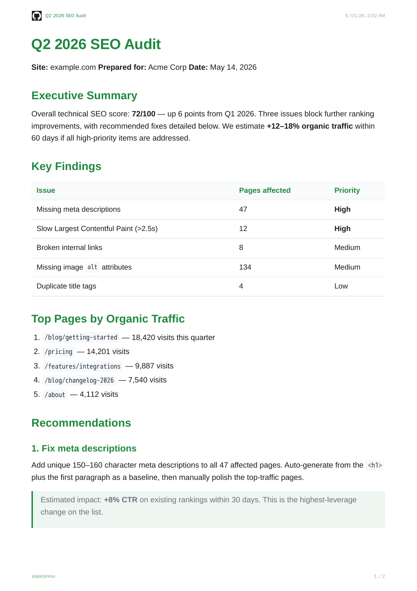
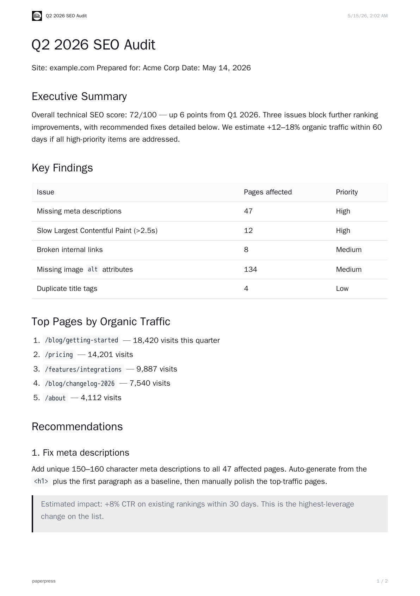
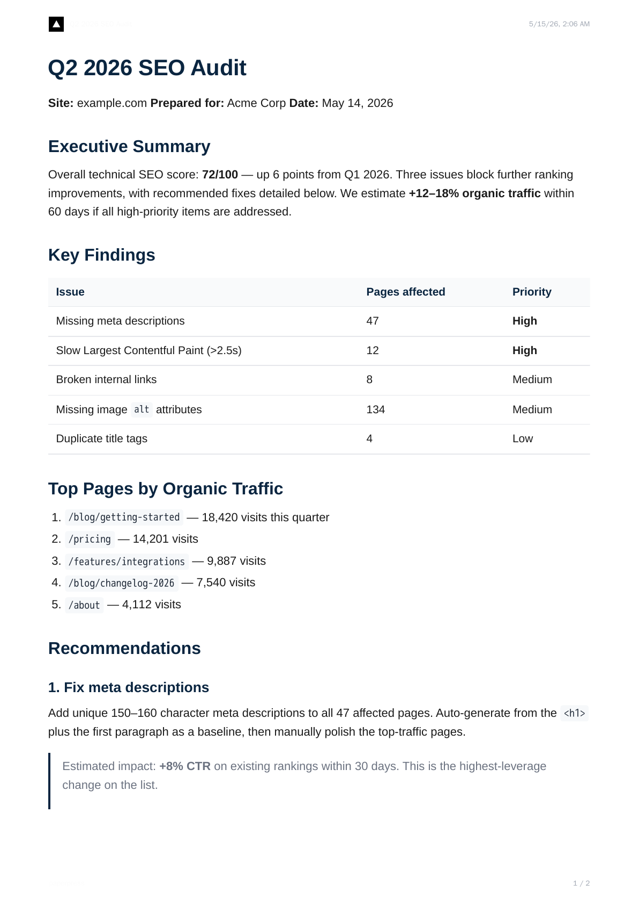
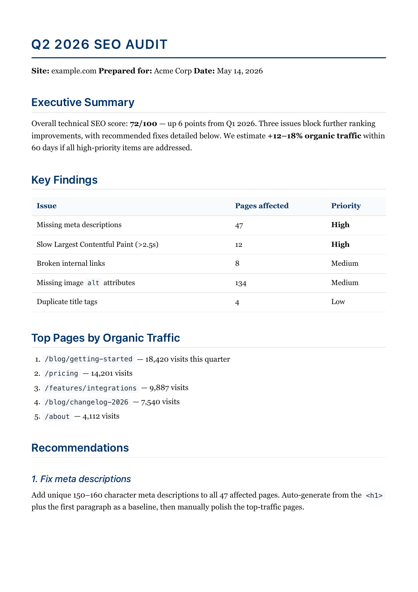
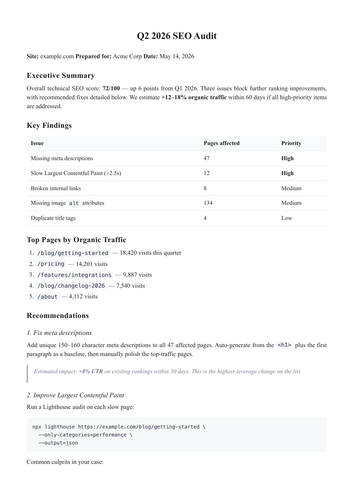
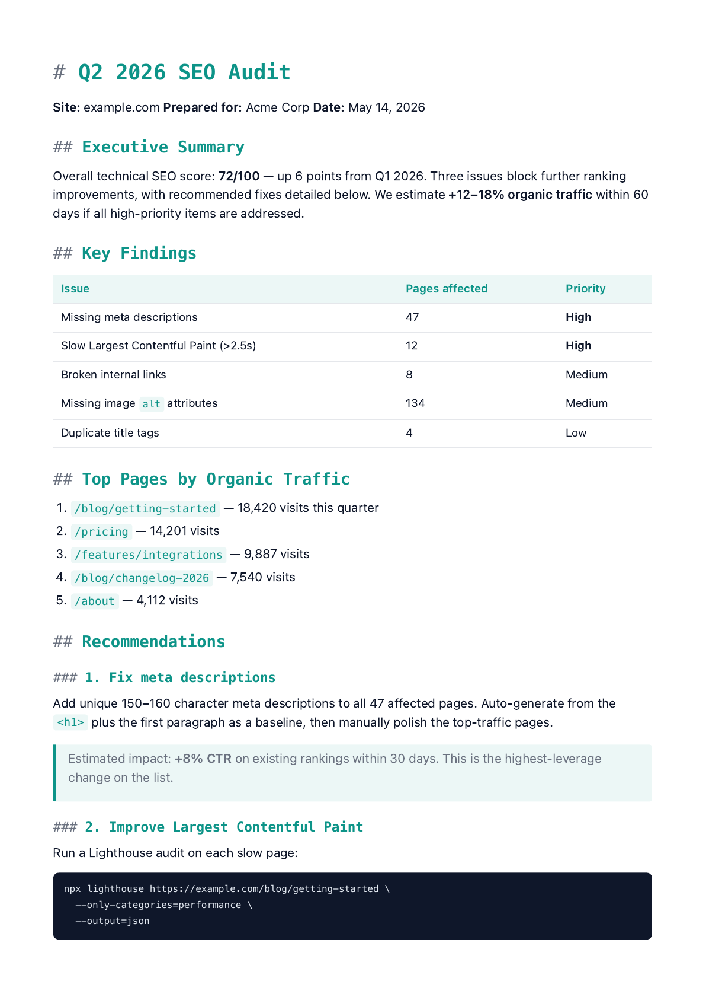
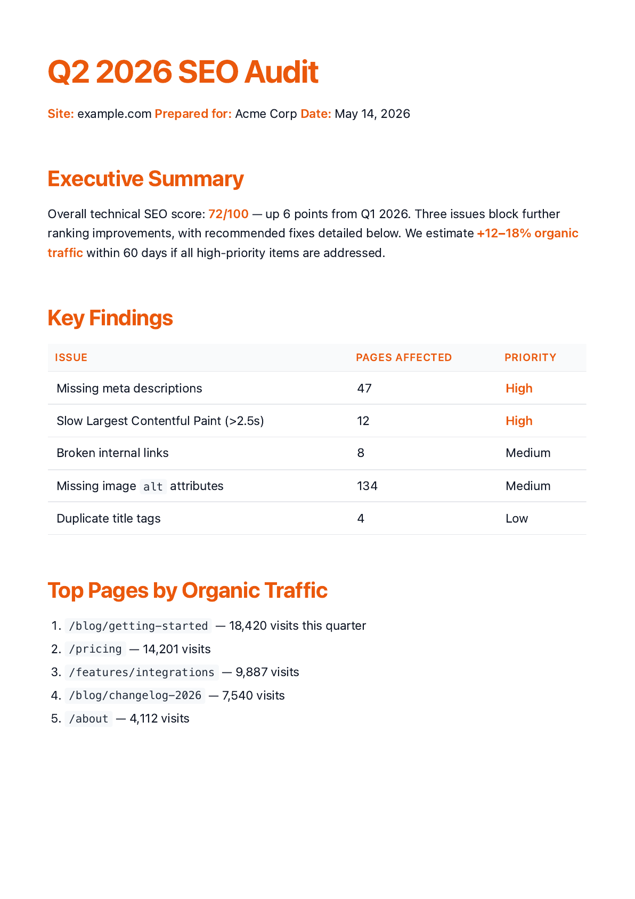

# paperpress

**Give it a company's URL and some markdown. Get back a PDF in that company's brand.**

One HTTP call. No signup, no API key. REST API plus a hosted MCP server, so AI agents can use it too.

[](LICENSE)
[](#use-it-from-an-ai-agent-mcp)
[](#try-it)

<table>
  <tr>
    <td align="center"><br><sub><code>stripe.com</code></sub></td>
    <td align="center"><br><sub><code>github.com</code></sub></td>
    <td align="center"><br><sub><code>railway.com</code></sub></td>
    <td align="center"><br><sub><code>vercel.com</code></sub></td>
  </tr>
</table>

<sub>The same markdown, four times. The logo, color and font in each were detected live from the URL underneath.</sub>

## Try it

Paste this into a terminal. It detects Stripe's brand and renders a sample report in it:

```bash
curl -X POST https://paperpress.up.railway.app/v1/demo \
  -H "Content-Type: application/json" \
  -d '{"url":"https://stripe.com"}'
```

You get back what was detected, plus a link to the PDF:

```json
{
  "detected": {
    "primaryColor": "#533afd",
    "logoUrl": "https://images.stripeassets.com/.../favicon.png",
    "fontFamily": "sohne-var, \"SF Pro Display\", sans-serif",
    "fontStyle": "sans"
  },
  "pdf": { "url": "https://paperpress.up.railway.app/pdf/...", "bytes": 59496 },
  "elapsedMs": 1484
}
```

Swap in any company's URL. To render your own markdown instead of the sample, use `/v1/documents`:

```bash
curl -X POST https://paperpress.up.railway.app/v1/documents \
  -H "Content-Type: application/json" \
  -d '{"markdown":"# Q4 report\n\nRevenue up 14%.","brandFromUrl":"https://stripe.com"}'
```

## Use it from an AI agent (MCP)

The server speaks MCP over Streamable HTTP at:

```
https://paperpress.up.railway.app/mcp
```

Add that URL to any MCP client. There's nothing else to configure: no key, no headers, no install. For clients that use an `mcpServers` config file:

```json
{
  "mcpServers": {
    "paperpress": { "url": "https://paperpress.up.railway.app/mcp" }
  }
}
```

It exposes one tool, `generate_pdf`, with the same inputs as `/v1/documents`. Ask your agent something like *"write a one-page board update and make it a PDF in Linear's brand"*, and it will call the tool with `brandFromUrl: "https://linear.app"` and hand you the link.

It's the standard transport, so it isn't tied to one vendor or model: it should work with Claude Desktop, Claude.ai connectors, Cursor, Claude Code, or an agent running a local model. It's verified against the raw `@modelcontextprotocol/sdk` client; the server never knows which model is on the other end.

## How it works

1. **Detect** ([`src/render/detect.ts`](src/render/detect.ts)). Opens the URL in headless Chromium and reads what the browser actually rendered: `theme-color`, brand CSS custom properties, the background color of call-to-action buttons, the computed `font-family`, and header `` candidates scored by position, size and format. Near-white, near-black and gray noise is filtered out, and a WCAG contrast check stops a too-light brand color from making text unreadable. Results are cached for 24 hours per site.
2. **Render** ([`src/render/`](src/render/)). Markdown becomes HTML via `unified`/`remark`/`rehype`, styled by one of five themes plus the brand kit, then printed to PDF by Playwright. Typically 100-400 ms once Chromium is warm.
3. **Serve.** PDFs are written to disk behind HMAC-signed links that expire after 7 days.

One Fastify process. No queue, no worker, no Redis, no database.

### Why it's built this way

- **It reads the live page, not a database.** Brand-data APIs like Brandfetch work from a crawled index, so they only know companies they've already seen. This reads the page at request time, so it works on any URL, including ones nobody has indexed. It also returns the exact font stack (`"sohne-var, SF Pro Display"`), not just `serif`/`sans`/`mono`, because it reads what the browser renders.
- **Detect and render happen in one call.** Normally you'd call a brand API, take the JSON, then call a separate PDF API with it: two round trips, two vendors, glue code in between. `brandFromUrl` does both in a single synchronous request, in about a second.

## API reference

Base URL: `https://paperpress.up.railway.app`. Every endpoint is anonymous.

| Method | Path | What it does |
|---|---|---|
| `POST` | `/v1/documents` | Markdown → PDF. Returns a signed link. |
| `POST` | `/v1/detect` | URL → detected brand kit, as JSON. |
| `POST` | `/v1/demo` | URL → detected brand kit plus a sample report rendered in it. |
| `POST` | `/mcp` | MCP endpoint, one `generate_pdf` tool. |
| `GET` | `/pdf/:id?exp=&sig=` | Download a rendered PDF (signed link). |
| `GET` | `/health` | `{ "status": "ok" }` |

### `POST /v1/documents`

| Field | Type | |
|---|---|---|
| `markdown` | string, required | Up to 500 KB. Headings, lists, tables, code blocks, blockquotes, links. |
| `brandFromUrl` | URL | Detect a brand from this page and apply it. |
| `brandKit` | object | Set brand fields directly: `primaryColor`, `accentColor` (hex), `logoUrl`, `fontFamily`, `headingFontFamily`, `fontStyle` (`serif`/`sans`/`mono`), `density` (`compact`/`normal`/`spacious`). Overrides anything detected. |
| `theme` | string | `clean` (default), `executive`, `academic`, `technical`, `marketing`. |
| `title` | string | Goes in the PDF metadata, and in the page header when a brand is applied. |
| `format` | string | `A4` (default), `Letter`, `Legal`. |
| `landscape` | boolean | Default `false`. |
| `css` | string | Raw CSS applied last, for one-off overrides. |

Response:

```json
{ "id": "bc79fc99-...", "url": "https://paperpress.up.railway.app/pdf/bc79fc99-...?exp=...&sig=...", "pages": 1, "bytes": 57139, "renderTimeMs": 101 }
```

### `POST /v1/detect`

Send `{ "url": "https://linear.app" }`. Results are cached for 24 hours per site; add `"refresh": true` to skip the cache. You get back `primaryColor`, `palette`, `logoUrl`, `favicon`, `fontFamily`, `headingFontFamily` and `fontStyle`. You can pass these straight back as a `brandKit`, adjusted if you like.

### Limits

Per IP address:

- **30 renders an hour**, shared between `/v1/documents` and the MCP tool.
- **30 an hour** each for `/v1/detect` and `/v1/demo`.
- **60 requests a minute** across everything.

Over a limit, the API returns `429` with a `Retry-After` header, and the MCP tool returns an error saying when to retry. A single document is capped at 200 pages.

## Themes

The same markdown in each built-in theme, with no brand applied:

<table>
  <tr>
    <td align="center"><br><sub><a href="samples/preview-clean.pdf"><code>clean</code></a></sub></td>
    <td align="center"><br><sub><a href="samples/preview-executive.pdf"><code>executive</code></a></sub></td>
    <td align="center"><br><sub><a href="samples/preview-academic.pdf"><code>academic</code></a></sub></td>
    <td align="center"><br><sub><a href="samples/preview-technical.pdf"><code>technical</code></a></sub></td>
    <td align="center"><br><sub><a href="samples/preview-marketing.pdf"><code>marketing</code></a></sub></td>
  </tr>
</table>

Every sample, including PDFs with inline brand kits, is in [`samples/`](samples/). Regenerate them with `npx tsx scripts/preview.ts`, or try detection on any URL with `npx tsx scripts/detect.ts <url>`.

## Run it yourself

Needs Node 20+.

```bash
cp .env.example .env    # set SIGNING_SECRET, e.g. `openssl rand -base64 32`
npm install             # also downloads Chromium for Playwright
npm run dev             # http://localhost:3000
```

```bash
curl -X POST http://localhost:3000/v1/documents \
  -H "Content-Type: application/json" \
  -d '{"markdown":"# Hello\n\nWorld."}'
```

| Variable | Default | |
|---|---|---|
| `SIGNING_SECRET` | *required* | Signs PDF download links. At least 16 characters. |
| `PUBLIC_BASE_URL` | `http://localhost:3000` | Used to build PDF links. |
| `STORAGE_DIR` | `./storage` | Where PDFs are written. Mount a volume here in production. |
| `PORT` | `3000` | |
| `PLAYWRIGHT_MAX_CONTEXTS` | `2` | Browser contexts in the pool, i.e. concurrent renders. |
| `RENDER_TIMEOUT_MS` | `30000` | Hard limit for any single page load or render. |
| `RENDERS_PER_HOUR` | `30` | Per-IP render budget. |
| `MAX_PAGES_PER_RENDER` | `200` | Larger documents are rejected with `413`. |

### Deploy

The [`Dockerfile`](Dockerfile) builds a single image on Microsoft's Playwright base, and [`railway.json`](railway.json) adds a health check. On Railway:

```bash
railway init --name paperpress
railway add --service paperpress \
  --variables "SIGNING_SECRET=$(openssl rand -base64 32)" \
  --variables "PUBLIC_BASE_URL=https://your-app.up.railway.app" \
  --variables "STORAGE_DIR=/data/storage" \
  --variables "NODE_ENV=production"
railway service paperpress
railway volume add --mount-path /data/storage   # so PDFs survive restarts
railway domain --port 3000
railway up --detach -c
```

Keep the Playwright version in the `Dockerfile` base image in step with the `playwright` npm package. If they drift apart, the browser binary won't be found and every render fails.

Rate limits key on Railway's `X-Real-IP` header ([`src/lib/client-ip.ts`](src/lib/client-ip.ts)). Behind a different proxy, check that it sets that header and doesn't pass a client-supplied one through.

## Security

- **SSRF.** Every caller-supplied URL (`brandFromUrl`, `logoUrl`, `/v1/detect`, `/v1/demo`) is resolved, and private, loopback and link-local addresses are rejected. Because a public host can redirect to a private one, the address is checked again on every redirect hop and after the page finishes loading. One gap remains: the first connection to a redirect target happens before that check can reject it, so a blind outbound request is possible, though nothing from a rejected target is ever read or returned. Closing that fully would need IP pinning at the network layer.
- **Script injection.** Markdown is rendered with raw HTML disabled. The `css` field rejects anything that could close the `<style>` block and inject a script into the browser.
- **Hung pages.** Some sites never finish loading (`airbnb.com` hung for over 60 seconds in testing), and Playwright's `page.evaluate()` has no timeout of its own. Every browser page is therefore raced against `RENDER_TIMEOUT_MS`, and on timeout its browser context is killed and replaced, so one bad site can't tie up the pool.
- **No accounts, no data.** There are no keys, emails or user records to leak. The trade-off is an open browser pool, which is why the per-IP limits exist.

## Known limitations

- **Pages that build their UI in JavaScript.** Detection reads the page as soon as the HTML has loaded, before client-side code runs. Server-rendered marketing sites work well. A single-page app like `open.spotify.com` gives you the logo but not the brand color, because its colored buttons don't exist yet at that point. Waiting longer fixed it but made every request 3-10x slower, so it was reverted. The commit history has the details.
- **No automated tests.** Everything was verified by hand against a running instance.
- **Single instance.** Rate limits and the detection cache live in memory, so they reset on restart and wouldn't be shared across replicas.
- **PDFs aren't cleaned up.** Links expire after 7 days, but the files stay on disk.

## About this project

paperpress was built and briefly run as a real service, with a plan to charge for it. Before investing further I looked hard at the market: Claude now generates PDFs natively, and Brandfetch already sells a brand-data API built for AI agents, with real customers. So I'm not pursuing it as a business.

It's public as a working reference: a Playwright brand detector, a synchronous render pipeline, an SSRF-hardened URL fetcher and a hosted MCP server, small enough to read in an afternoon. The hosted instance stays up for anyone to try. It isn't maintained as a product.

## License

[MIT](LICENSE)
